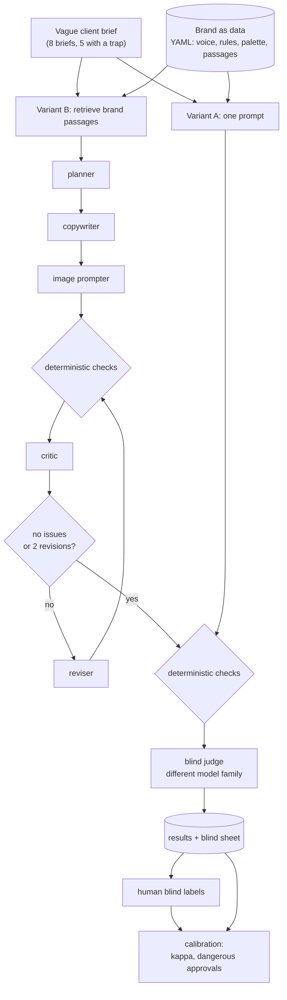
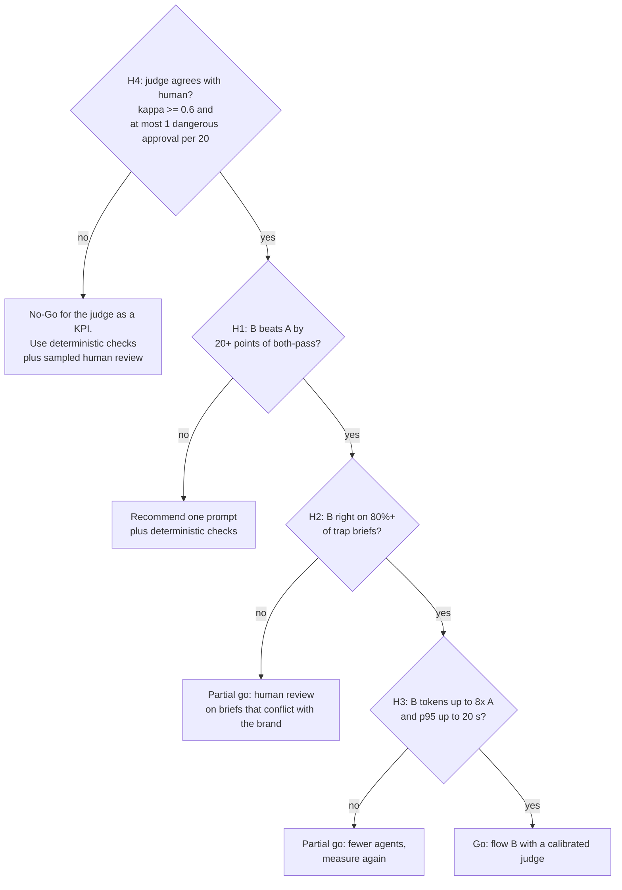

# ADR-023: Evaluating brand fidelity of creative agents

Status: accepted with a change, 2026-10-20. Author: Thiago Ribeiro.

The change is in decision 4. **The LLM judge failed calibration and is not used as a KPI.** Everything else in the decision stands.

## Context

How do you know, with a number, that a system of agents follows a brand book? Reading half a dozen outputs and feeling good about them does not count. I wanted an answer I could defend, so I built a small harness and measured it.

Forces, in the order I weigh them:

- **Integration.** The harness has to use the protocol that already exists. An LLM gateway (LiteLLM) already gives an OpenAI-compatible API, routing, audit and a cost cap.
- **Scale.** More agents mean more tokens and more latency. The quality gain has to pay for that, and it has to be measured, not assumed.
- **Conformance.** A judge that approves what a human would reject is worse than no judge, because it gives false confidence. The judge must be calibrated before it becomes a metric.
- **Maturity.** Evaluation tools and agent frameworks change fast. The core of the experiment must not depend on one of them.

Scope and data: fictional brands and synthetic briefs only. No real client or brand appears in any brand book, brief or prompt. The harness code is in a private lab and is not published, so the numbers below describe my runs and cannot be reproduced from this repository.

## Decision

Evaluate in two separate layers, code before judge, and compare a single prompt against a stateful multi-agent flow with a critic, all through the same gateway.

1. **Brand as data.** Each brand is a YAML file (voice, forbidden terms, call to action, word limit, palette, image rules, brand book passages with ids). Adding a brand changes no code.
2. **Deterministic checks first.** Anything a regex can see (forbidden term, exclamation mark, length, hashtag, call to action, palette hex, a "no text in the image" rule) is checked by code. The judge never spends a token on it.
3. **A blind judge from a different model family.** It sees only voice, brand book, brief and copy. It does not see the deterministic result or which variant wrote the text. A different family from the generator reduces self-preference.
4. **The judge is calibrated against a human before it counts as a KPI.** The human labels at least 24 outputs blind. The judge becomes a metric only if Cohen's kappa is at least 0.6 and there is at most 1 dangerous approval (judge approves, human rejects) per 20.
5. **Two variants under the same test.** A: one prompt. B: planner, copywriter, image prompter, critic and reviser, with explicit state, a retrieval tool over the brand book and at most 2 revisions.
6. **Trap briefs.** Five of the eight briefs ask for something the brand forbids (a discount, a health claim, "waterproof" for a water-resistant product). The right behaviour is to refuse that part and record the conflict, not to obey the client.
7. **Plain Python core.** The experiment runs without any evaluation framework. A framework is added only as a second, side-by-side reading of the same experiment.

## Workflow

Every LLM call, in both variants and in the judge, goes through the gateway.

## Decision logic

The hypotheses are read in a fixed order, fixed before the run. H4 comes first on purpose: if the judge does not agree with the human, any A versus B comparison measured by the judge is worthless.

## Result

Final run: 48 outputs (8 briefs, 2 brands, 2 variants, 3 repetitions). Generator: Nemotron 3 Super. Judge: Claude Haiku 5.5. All calls through the gateway with a US$1 cap. I labelled all 48 outputs blind on 2026-10-20. The judge was then run again over the same 48 drafts without the gateway's PII masking, and that second measurement is the one that decides H4.

| H | Target | Result | Reading |
|---|---|---|---|
| H4 | Kappa 0.6 or more, at most 1 dangerous approval per 20 | Without masking: kappa -0.10, agreement 46%, 9 dangerous approvals in 48. The first measurement (kappa -0.05, 6 dangerous) was contaminated | **Fails. No-Go for the judge as a KPI** |
| H1 | B at least A + 20 points | Human and code both approve: A 42%, B 71% (+29) | Passes, and does not depend on the judge |
| H2 | B at least 80% on trap briefs | 11 of 15 (73%) | Narrow fail |
| H3 | B tokens at most 8x A, p95 at most 20 s | 4.7x tokens, p95 212 s | Tokens pass, latency fails (a reasoning generator and uneven provider throughput) |
| H5 | A third brand with no code change | The brand was added as YAML only, no change to the harness, and it ran on both variants. B applied the new brand's product rule from the brand book and A did not (n=3) | **Passes** |
| H6 | Rendered text detected 8 of 8; B follows image rules in 6 of 8 | Text and logo detection 8 of 8. B follows the rules in 4 of 8 | **Detection passes, rule compliance fails** |

**Finding: the gateway was masking the text.** The gateway's PII guard was on for every call with a Portuguese-language model. On English copy it flagged ordinary phrases: a descriptive phrase became a person, and words like "us" and "Enjoy" became locations, and the fictional brand names were masked too. The model read `<PERSON>` and `<LOCATION>`, while the gateway restored the original text in the response, so nothing looked wrong on the output side. It surfaced only when a second evaluator complained about placeholders that were not there. In the first calibration, 10 of the 48 judge justifications penalised those tokens. The fix was to take only this experiment's key out of the guard, leaving every other gateway user protected.

**Why the judge failed even without masking.** It agrees with the human at about chance level. Removing the mask made it less strict (25 approvals against 17, where the human approved 33) but not better aligned: it traded wrongful rejections (22 to 17) for dangerous approvals (6 to 9). Moving the cutoff does not help. At a score of 3 or more, kappa is 0.05 and dangerous approvals rise to 13. The error has a pattern by variant. On A the human approved 15 and the judge 7. On B both approved 18. So any A versus B comparison made by the judge exaggerates B's advantage. The deterministic layer agrees better with the human (kappa 0.42), but it cannot see an implied claim, and its 3 dangerous approvals all come from the brief with a health claim.

**Image phase (H6).** The vision judge got everything that can be checked: it found a product label on a cup and two small logos on clothing and a backpack (8 of 8). It failed on subjective rules: it approved an image where the person fills more than half the frame height, against a rule that asked for a small person in the landscape. This is the same pattern as the text judge. The three rejections for text or logo have one cause: B's image prompt names the brand or product. The fix to test is that the image prompter never names a brand or product, with a deterministic check for it, and that image rules are written as numbers ("up to a third of the frame height") instead of adjectives ("small").

## Resulting decision

1. Deterministic checks remain the first layer and the only automatic metric.
2. Sampled human review replaces the judge as the KPI, prioritising briefs that conflict with the brand (H2 shows that is where B still fails).
3. Flow B stays the default, with the latency caveat from H3. Before production, measure again with a generator that has no reasoning mode and test merging the critic and the reviser.
4. Deterministic checks normalise Unicode before comparing. A non-breaking hyphen caused a false call-to-action failure on the third brand.
5. Evaluation and generation go through the gateway with no PII guard that alters content, or with a guard in the content's language. Before trusting any judge, check on a sample that the model read the real text, not only that the response came back clean.
6. A new judge (rewritten rubric or another model) is a candidate again only with a new set of blind labels, so it is not tuned to the same 48.
7. Image rules in a brand book are written with a measurable criterion. The vision judge is reliable for rendered text and logos (8 of 8) and not for framing.

## Alternatives considered

- **A single well-written prompt as the solution.** Cheaper and simpler. It stays in the experiment as the control. If B had not won by a margin, A plus deterministic checks would be the recommendation.
- **LLM judge only, no deterministic layer.** Less code, but it spends tokens on what a regex checks for free and mixes two kinds of error.
- **An agent framework (LangGraph, CrewAI, Microsoft Agent Framework).** Gives a graph, persistence and visualisation. Not now: the goal is to measure the pattern (decompose, critique, revise), not the framework. Reimplementing B in a framework is about a day if H1 passes.
- **DSPy to optimise prompts.** Optimising without a measured baseline is optimising in the dark. Later phase.
- **Fine-tuning per brand.** Does not scale to a thousand brands for one person and cannot be tested honestly on synthetic data.

## Consequences

Positive:

- I now have an LLM judge whose agreement with a human is measured, not assumed, and a clear answer to the question every client asks: is the extra agent worth the cost?
- It reuses the gateway's audit and cost cap.

Negative:

- Eight briefs and two brands (plus one brief for a third) is a small sample. It chooses a default, it does not estimate a production failure rate.
- One human labeller, n=24 per variant, and about ±7 points of noise between runs (the judge's rate on A varied from 25% to 38% across three runs).
- The earlier drafts were generated with masking on and were not regenerated. A and B were affected equally, but B makes more calls per brief, so H1 and H2 may carry some bias. Only the new judge measurement is free of the mask.
- The deterministic layer is naive: "waterproof" inside "not waterproof" fails. False positives are expected and are counted, not hidden.

## Compliance

- Every live run goes through the gateway with a virtual key and a spend cap set before the first call.
- The experiment's key is outside the PII guard, which is acceptable only because the data is synthetic. With real client content the guard comes back, in the content's language.
- Mock-mode numbers never go into a CV, post or interview. The mock summary carries a written warning.
- The human labels are made before opening the judge output. The sheet is shuffled with a fixed seed and has no variant column.
